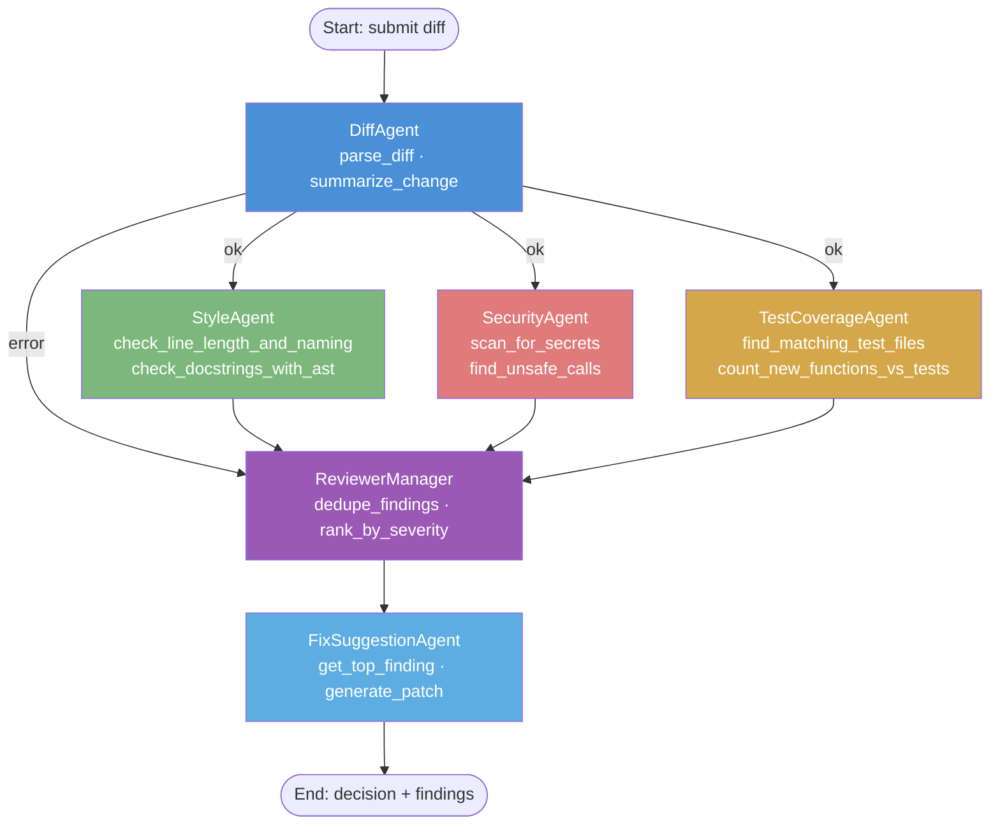
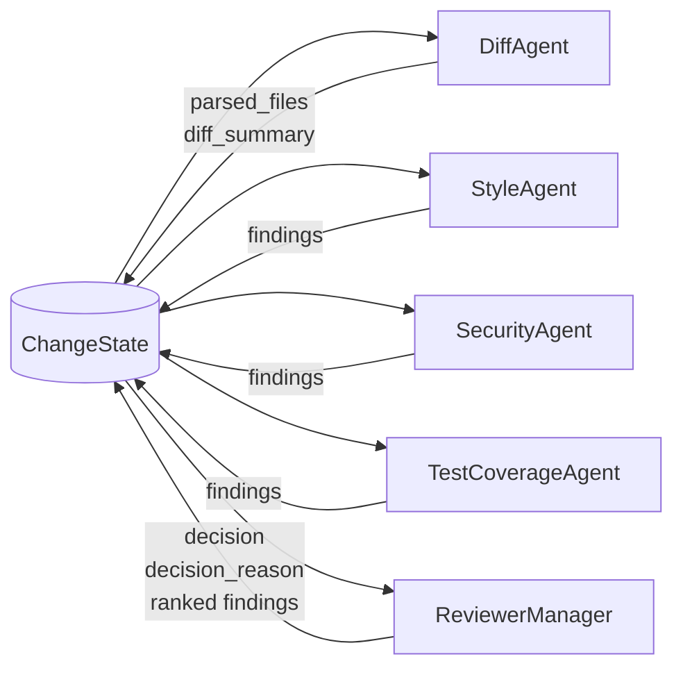

# Architecture — Automated Code Review Board

## Fan-Out / Fan-In Diagram



## Shared State Flow



## Decision Rule (ReviewerManager)

```
if state.error         → CANNOT_REVIEW
elif any HIGH finding  → REQUEST_CHANGES
elif MEDIUM count ≥ 2  → REQUEST_CHANGES
else                   → APPROVE
```
